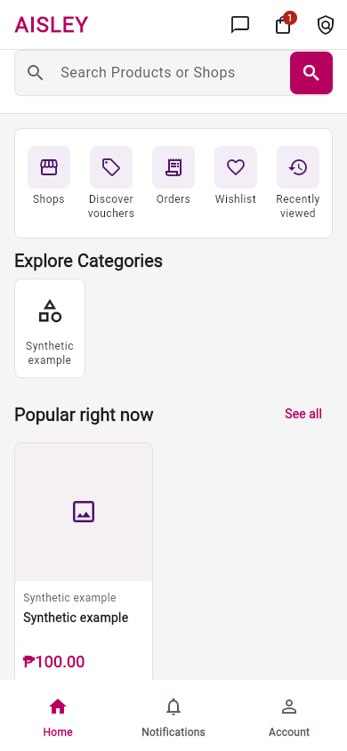
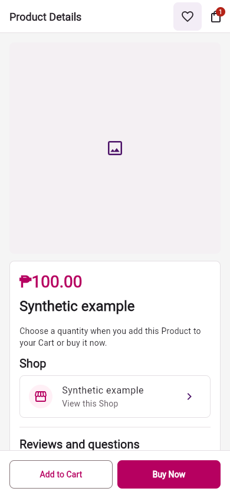
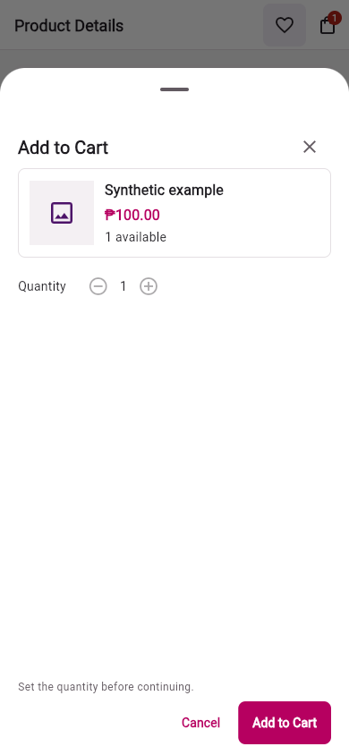
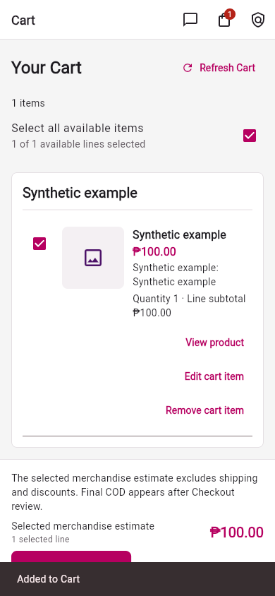
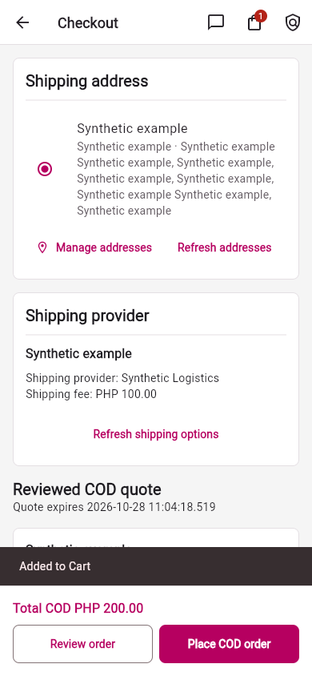
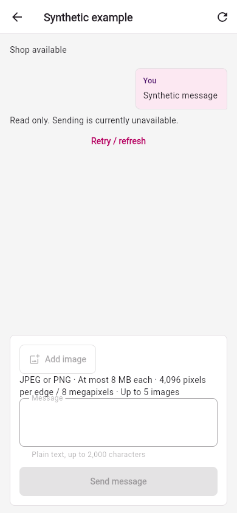

# AISLEY Customer Stitch implementation report — 2026-10-28

## Status and scope

The selected 22-screen Stitch revision-2 presentation is implemented locally across existing Buyer Flutter routes and presentation overlays. This report maps each selected reference to its current source area. The approved voucher changes pass focused and standard-assets suite checks at the current candidate snapshot. Post-fix web and release APK builds, final formatting and analyzer have passed; the APK artifact and parity across the checkout and sanitized copies are verified. This report does not claim pixel-perfect reproduction, live API acceptance, installed-device accessibility or release readiness.

Reference authority is [the selected manifest](../stitch/manifest.json) and [revision 2](../stitch/revision-2.md). [The original review](../stitch/review.md) and first-generation request wording remain historical. The selected local PNG resources and hashes are unchanged by this report. The Lead independently verified all 22 selected remote IDs against the local manifest and verified the local PNG signatures/dimensions/checksums.

The implementation remains in the working tree without a commit; the Implementor plans a conventional commit after final gates. The manifest’s `sourceCommit` records the source inspected before design work, not the implementation source. Platform contract adoption remains `1858785e` plus its historical per-feature slices; the deployed backend revision is unidentified. No backend/API, dependency, authorization, payload, or raw generated design-system change is part of this UI adoption.

## Adopted presentation

- Phone/tablet shell destinations are Home, Notifications and Account. Shared header utilities are Messages, Cart and Terms/Privacy. Shops and Cart are pushed pages with predictable Back. Desktop uses Home/Shops/Orders/Notifications/Account navigation and the same header utilities.
- Product Detail has a Wishlist and Cart toolbar on phone; desktop retains shared navigation/utilities and adds Wishlist in the Product toolbar.
- Home shows no Product-card quick-add control. Product cards open Product Detail. A supported Search-result Add-to-Cart action uses the same current-detail purchase flow as Product Detail.
- Product Detail has no inline quantity or preselected SKU. Simple and variant Products use the same bounded, scrollable purchase sheet on phone or dialog on wider layouts. Simple Products show quantity only; variants require a current complete server-listed option combination. Add-to-Cart and Buy-Now confirmation labels follow their separate actions. Opening or closing/cancelling performs no write. Buy Now retains its separate Checkout intent and does not modify Cart.
- Cart-line editing remains its own flow. The selected-line merchandise amount is labeled an estimate and excludes shipping and discounts; the reviewed Checkout quote remains authoritative for COD totals.
- Existing session/consent guards, repositories, server eligibility/prices/stock, quote/placement recovery, Order and voucher projections, and separate Shop/Logistics/Courier message permissions retain their owners. Generated Stitch tokens, Roboto Flex and metadata/badges are not adopted; the established neutral Buyer palette and Material font remain.

## Reference-to-source coverage

The numbered entries are reference labels, not new routes. “Source area” lists the current presentation files that implement the represented flow; several related references intentionally reuse a screen or overlay.

| Ref | Reference and existing flow | Current Flutter source area |
| --- | --- | --- |
| 01 | Home, `/` | `lib/features/discovery/presentation/home_screen.dart`; `lib/features/discovery/presentation/home_shopping_shortcuts.dart`; `lib/features/discovery/presentation/home_campaign_banner.dart`; `lib/features/discovery/presentation/catalog_widgets.dart` |
| 02 | Product Details, `/products/:id` | `lib/features/discovery/presentation/product_detail_screen.dart`; `lib/features/discovery/presentation/product_information.dart`; `lib/features/discovery/presentation/product_purchase_actions.dart` |
| 03 | Quantity and SKU Selection, purchase overlay | `lib/features/discovery/presentation/product_purchase_flow.dart`; `lib/features/discovery/presentation/product_choices.dart` |
| 04 | Cart, `/cart` | `lib/features/cart/presentation/cart_screen.dart`; `lib/features/cart/presentation/cart_item_row.dart` |
| 05 | Checkout, `/checkout` | `lib/features/checkout/presentation/checkout_screen.dart`; `lib/features/checkout/presentation/checkout_address_section.dart`; `lib/features/checkout/presentation/quote_review.dart`; `lib/features/checkout/presentation/voucher_savings_summary.dart` |
| 06 | Checkout Recovery, unresolved placement | `lib/features/checkout/presentation/checkout_screen.dart`; `lib/features/checkout/presentation/pending_checkout_summary.dart`; `lib/features/checkout/presentation/batch_result_screen.dart` |
| 07 | Search, `/search` | `lib/features/discovery/presentation/search_screen.dart`; `lib/features/discovery/presentation/catalog_widgets.dart`; `lib/features/discovery/presentation/product_purchase_flow.dart` |
| 08 | Shops directory, `/shops` | `lib/features/discovery/presentation/shop_directory_screen.dart`; `lib/features/discovery/presentation/catalog_widgets.dart` |
| 09 | Shop Storefront, `/shops/:slug` | `lib/features/discovery/presentation/shop_screen.dart`; `lib/features/shop_messages/presentation/shop_screens.dart` |
| 10 | Account, `/account` | `lib/features/account/presentation/account_home_screen.dart` |
| 11 | Orders, `/orders` | `lib/features/orders/presentation/orders_screen.dart` |
| 12 | Order Details and Tracking, `/orders/:order` | `lib/features/orders/presentation/order_detail_screen.dart`; `lib/features/orders/presentation/order_facts.dart`; `lib/features/orders/presentation/order_timeline.dart` |
| 13 | Vouchers, `/vouchers` and account wallet | `lib/features/vouchers/presentation/voucher_screens.dart`; `lib/features/vouchers/presentation/voucher_card.dart` |
| 14 | Messages, `/messages` | `lib/features/messaging/presentation/message_center_screen.dart`; `lib/features/messaging/presentation/inbox_view.dart`; `lib/features/messaging/presentation/message_views.dart`; `lib/features/messaging/presentation/conversation_tile.dart` |
| 15 | Shop Conversation | `lib/features/shop_messages/presentation/shop_screens.dart`; `lib/features/messaging/presentation/message_views.dart`; `lib/features/messaging/presentation/message_bubble.dart` |
| 16 | Sign In, `/login` | `lib/features/auth/presentation/login_screen.dart`; `lib/core/ui/form_page.dart` |
| 17 | Required Consent, `/consent` | `lib/features/policies/presentation/consent_screen.dart`; `lib/core/ui/form_page.dart` |
| 18 | Address Book, `/account/addresses` | `lib/features/addresses/presentation/address_book_screen.dart` |
| 19 | Simple Product Details, `/products/:id` | `lib/features/discovery/presentation/product_detail_screen.dart`; `lib/features/discovery/presentation/product_purchase_actions.dart` |
| 20 | Simple quantity — Add to Cart, purchase overlay | `lib/features/discovery/presentation/product_purchase_flow.dart`; `lib/features/discovery/presentation/product_choices.dart`; Cart operation remains owned by `lib/features/cart/presentation/cart_controller.dart` |
| 21 | Simple quantity — Buy Now, purchase overlay | `lib/features/discovery/presentation/product_purchase_flow.dart`; `lib/features/discovery/presentation/product_choices.dart`; Checkout intent remains owned by `lib/features/checkout/presentation/checkout_controller.dart` |
| 22 | Notifications, `/notifications` | `lib/features/notifications/presentation/notification_screens.dart` |

The full route/spec mapping, unillustrated routes and state caveats remain in [screen-map.md](../stitch/screen-map.md). The design files do not imply that every existing route/error state has a separate screenshot.

## Role ownership, skills and runtime

| Assignment / role | Ownership and status | Skills used or considered |
| --- | --- | --- |
| Task 001 — Implementor bootstrap | Root ignore rule for temporary session memory; complete. | No feature skill reported. |
| Task 003 — Foundation, navigation, discovery and Product Implementor | Shared shell/theme/router/header, Home/Shops/Search/Product presentation and related harness/tests; implementation complete. | `dart-flutter:flutter-build-responsive-layout`, `dart-flutter:flutter-add-widget-test`, and `dart-flutter:dart-run-static-analysis` used. `dart-flutter:flutter-add-widget-preview` was inspected but not used because no preview infrastructure was available. `uncodixfy` was compatible but not applied. |
| Task 004 — Cart, Checkout, Orders and vouchers Implementor | Cart/Checkout/Orders/Vouchers presentation and related tests; implementation complete. Existing controllers were unchanged. | `dart-flutter:flutter-build-responsive-layout`, `dart-flutter:flutter-add-widget-test`, and `dart-flutter:dart-run-static-analysis` used. |
| Task 005 — Account and communications Implementor | Account/Auth/Consent/Addresses/Messaging/Notifications supporting presentation and tests; implementation complete, 96/96 task-scoped checks reported passing. | `dart-flutter:flutter-build-responsive-layout`, `dart-flutter:flutter-add-widget-test`, and `dart-flutter:dart-run-static-analysis` used. |
| Lead | Coordinates assignments and verification gates; no product-file ownership in this role. | `orchestrator` coordination instructions. Lead runtime was not changed by this delegation; effective model/effort are unverified. |
| Documentor — tasks 006 and 008 | Assigned project docs and sole author of this session’s Markdown memory; task 006 completed, task 008 closes this ownership/evidence update. | `orchestrator` Documentor/session-memory contracts and the local Customer documentation rules used. `feature-spec` was inspected; its `/idea` and `/spec` workflow was not applied. |
| Task 009 — Independent Tester | Read-only final regression, contract, reliability, build and artifact-parity checks complete; report at `/tmp/buyer-stitch-final-test-report.md`. No project files changed. | No separate tester skill use was recorded; the report lists commands and evidence. |
| Task 010 — UI reviewer | Read-only screenshot and post-fix source review complete; report/addendum at `/tmp/buyer-stitch-final-ui-review.md`. No project files changed. Voucher state was source-reviewed; no voucher-bearing runtime capture exists. | `orchestrator` discovery/contracts and UI-review role instructions were followed; `dart-flutter:flutter-build-responsive-layout` was used as a review checklist. |
| Task 011 — Documentor | r005 report and session-memory update complete; no product code/test/config edits. | `orchestrator` Documentor/session-memory contracts and local Customer documentation rules. |
| Task 012 — Voucher remediation Implementor | User-approved correction complete in `quote_review.dart`, `voucher_savings_summary.dart` and `checkout_voucher_names_test.dart`; focused verification passed. | No new skill-use evidence supplied for this focused remediation. |
| Task 013 — Commerce retest Tester | Read-only post-fix tests/builds complete: focused 38/38, full suite 952/42/0, format/analyzer/web/APK and 392-file parity pass. | No additional skill use reported. |
| Task 014 — Documentor | Six hash-verified synthetic captures and UI-review evidence appendix; complete. | `orchestrator` Documentor/session-memory contracts and local Customer documentation rules. |
| Task 015 — Documentor | Final evidence, current worktree inventory and dated Progress entry; complete. | `orchestrator` Documentor/session-memory contracts and local Customer documentation rules. |

All specialist launches requested GPT-6 Luna/max and were accepted at launch; effective model and effort are unverified. The Lead’s runtime was not changed and is also unverified. These notes distinguish launch acceptance from effective runtime metadata.

## Actual working-tree changes at checkpoint r009

This is the current `git status --short --untracked-files=all` inventory (84 paths), grouped by area. The 22-reference map above may include unchanged source; this table lists only modified or untracked files. Session memory is ignored under `.orchestrator/tmp/` and recorded separately.

| Work area | Modified or new paths |
| --- | --- |
| Bootstrap configuration (1) | `.gitignore` |
| Shared app and presentation UI (8) | `lib/app/communication_routes.dart`; `lib/app/router.dart`; `lib/app/shell_screen.dart`; `lib/app/theme.dart`; `lib/core/ui/form_page.dart`; `lib/core/ui/marketplace_chrome.dart`; `lib/core/ui/marketplace_surfaces.dart`; `lib/core/ui/marketplace_widgets.dart` |
| Discovery and Product (12) | `lib/features/discovery/presentation/catalog_widgets.dart`; `lib/features/discovery/presentation/home_screen.dart`; `lib/features/discovery/presentation/home_shopping_shortcuts.dart`; `lib/features/discovery/presentation/product_card_information.dart`; `lib/features/discovery/presentation/product_choices.dart`; `lib/features/discovery/presentation/product_detail_screen.dart`; `lib/features/discovery/presentation/product_information.dart`; `lib/features/discovery/presentation/product_purchase_actions.dart`; `lib/features/discovery/presentation/product_purchase_flow.dart`; `lib/features/discovery/presentation/search_screen.dart`; `lib/features/discovery/presentation/shop_directory_screen.dart`; `lib/features/discovery/presentation/shop_screen.dart` |
| Cart, Checkout, Orders and vouchers (14) | `lib/features/cart/presentation/cart_item_row.dart`; `lib/features/cart/presentation/cart_screen.dart`; `lib/features/checkout/presentation/batch_result_screen.dart`; `lib/features/checkout/presentation/checkout_screen.dart`; `lib/features/checkout/presentation/quote_review.dart`; `lib/features/checkout/presentation/voucher_savings_summary.dart`; `lib/features/orders/presentation/order_detail_screen.dart`; `lib/features/orders/presentation/order_facts.dart`; `lib/features/orders/presentation/order_timeline.dart`; `lib/features/orders/presentation/orders_screen.dart`; `lib/features/vouchers/presentation/voucher_card.dart`; `lib/features/vouchers/presentation/voucher_screens.dart`; `lib/features/checkout/presentation/checkout_address_section.dart`; `lib/features/checkout/presentation/pending_checkout_summary.dart` |
| Account and communications (10) | `lib/features/account/presentation/account_home_screen.dart`; `lib/features/addresses/presentation/address_book_screen.dart`; `lib/features/auth/presentation/login_screen.dart`; `lib/features/messaging/presentation/conversation_tile.dart`; `lib/features/messaging/presentation/inbox_view.dart`; `lib/features/messaging/presentation/message_bubble.dart`; `lib/features/messaging/presentation/message_views.dart`; `lib/features/notifications/presentation/notification_screens.dart`; `lib/features/policies/presentation/consent_screen.dart`; `lib/features/shop_messages/presentation/shop_screens.dart` |
| Automated tests (15) | `test/core/marketplace_chrome_test.dart`; `test/features/checkout_recovery_widgets_test.dart`; `test/features/checkout_voucher_names_test.dart`; `test/features/home_campaign_test.dart`; `test/features/message_center_widgets_test.dart`; `test/features/phase_3_widgets_test.dart`; `test/features/phase_4_widgets_test.dart`; `test/features/phase_5_accessibility_test.dart`; `test/features/product_purchase_flow_test.dart`; `test/features/required_signin_test.dart`; `test/features/responsive_layout_test.dart`; `test/features/shop_context_widgets_test.dart`; `test/features/widgets_test.dart`; `test/features/stitch_navigation_test.dart`; `test/features/stitch_supporting_test.dart` |
| Browser harness (2) | `tool/browser_smoke.py`; `tool/browser_synthetic.py` |
| Project guides, Progress, Customer specs and Stitch docs (15) | `docs/PROGRESS.md`; `docs/architecture.md`; `docs/design-buyer.md`; `docs/features/customer/browse-shop/spec.md`; `docs/features/customer/customer-homepage/spec.md`; `docs/features/customer/customer_verify_auth/spec.md`; `docs/features/customer/notifications/spec.md`; `docs/features/customer/search/spec.md`; `docs/features/customer/view-cart/spec.md`; `docs/features/customer/view-product/spec.md`; `docs/stitch/DESIGN.md`; `docs/stitch/README.md`; `docs/stitch/manifest.json`; `docs/stitch/screen-map.md`; `docs/workspace.md` |
| Implementation report and preserved screenshots (7) | `docs/reports/stitch-implementation-2026-10-28.md`; `docs/reports/stitch-implementation-2026-10-28/cart-390.png`; `docs/reports/stitch-implementation-2026-10-28/checkout-390.png`; `docs/reports/stitch-implementation-2026-10-28/home-390.png`; `docs/reports/stitch-implementation-2026-10-28/messages-390.png`; `docs/reports/stitch-implementation-2026-10-28/product-390.png`; `docs/reports/stitch-implementation-2026-10-28/sheet-add-390.png` |

No Cart/Checkout controller, API contract/client, dependency lockfile or backend file appears in this inventory. Commerce changes are presentation, related tests and new presentation components; server/controller authority remains unchanged.

## Verification and acceptance ledger — checkpoint r009

### Post-remediation Tester update

The independent Tester reports the post-fix current checkout and sanitized snapshot match across 392 files with SHA-256 `69813cbb3d662fc56c4a7241f6dcdc3c38bc5d0df34c05af513f37cfbe35b31d`. Testing/building used the isolated `/tmp` source copy and synthetic public configuration; no `.env*` content was read, printed, copied or changed.

| Check | Current post-fix status |
| --- | --- |
| Focused voucher suite | **Pass: 38/38.** `flutter --suppress-analytics test --no-pub --concurrency=2 --reporter expanded --timeout 60s test/features/checkout_voucher_names_test.dart test/features/checkout_recovery_widgets_test.dart test/features/voucher_widgets_test.dart`. Covers selection/replacement, summary layouts and checkbox name/benefit semantics. |
| Full standard-assets Flutter suite | **Pass: 952 passed, 42 intentional skips, 0 failures.** `flutter --suppress-analytics test --no-pub --concurrency=2 --reporter expanded --timeout 60s --name '^(?!(?:shop|logistics|courier) refresh supersedes delayed append (?:success|failure)$).*'`. Excludes only six inherited inbox-refresh tests. Synthetic config, parity-matched copy. |
| Source/snapshot parity | **Pass.** Current checkout, candidate, separate web and APK copies match across 392 files at SHA-256 `69813cbb3d662fc56c4a7241f6dcdc3c38bc5d0df34c05af513f37cfbe35b31d`. |
| Web build | **Pass post-fix**, 68 seconds: `flutter --suppress-analytics build web --no-pub` in the sanitized web copy. Log `/tmp/buyer-stitch-postfix-web.log`. |
| Final formatting | **Pass:** `dart --suppress-analytics format --output=none --set-exit-if-changed` on the three changed Dart files; 0 formatting changes. |
| Final analyzer | **Pass:** `flutter --suppress-analytics analyze --no-pub`; no issues found in the sanitized candidate. |
| Release APK build | **Pass:** `flutter --suppress-analytics build apk --release --no-pub`, 138.5 seconds, 95.9 MB. Artifact `/tmp/buyer-stitch-postfix-builds-n0fga_vh/apk/source/build/app/outputs/flutter-apk/app-release.apk`. Compile evidence only; no production signing or installed-device acceptance. |
| Direct bundle validator | **Pass:** 1,173 local links, 22 Customer specs, 19 PSGC checksum/registration checks, Android boundaries. |
| Bundle validator regression unit tests | **3/4 pass; one inherited docs-only fixture failure** reproduces on untouched baseline HEAD because the copied-doc fixture omits root/source targets linked from unchanged `docs/stitch/DESIGN.md`. No remediation is assigned. |
| Whitespace | **Pass:** `git diff --check` and the report/image link/hash checks passed at closeout. |

Post-fix implementation tests, parity and build verification are complete in sanitized copies. No production signing, installed-device or live API acceptance follows from these checks.

### Pre-remediation baseline (historical)

The original tester report `/tmp/buyer-stitch-final-test-report.md` describes source fingerprint `c055b179b6843a2dccc727b795d61bcf2ae20d1b02fb7a0d3f4f46ace7e7e043`, before the approved voucher fix. At that snapshot, standard Flutter test assets yielded 937 passed / 42 skipped / 15 failed, all 15 in `checkout_voucher_names_test.dart`; the same 20-test file passed 20/20 on untouched baseline HEAD `5f29d2c51245f034f89fec656e0c553e1b673e90`. The requested `--no-test-assets` run yielded 909 passed / 42 skipped / 43 failed: 29 missing Ink Sparkle shader failures caused by omitted Flutter test assets, plus the 14 voucher copy assertions. This is a historical harness limitation, not the current suite result.

The pre-fix section of the updated Tester report records 58 Dart files formatted with zero changes, a clean analyzer, and pre-fix web/APK builds. The later post-fix section supersedes those results; current web/APK artifact, parity, formatting and analyzer results are confirmed in the table above. Task 004's earlier focused 25-test command is separate: it ran in the original checkout with default asset packaging, not `--no-test-assets` or synthetic isolation. Whether that compilation included `.env` is unconfirmed. The tester's isolated `/tmp` checks excluded `.env*` and used only synthetic public placeholders.

### Finding disposition

- **TEST-001 — inherited docs bundle fixture limitation (low, outside UI scope):** one `verify_bundle_test.py` case fails on both candidate and untouched baseline because its docs-only fixture omits root/source targets referenced by unchanged Stitch DESIGN. The full `verify_bundle.py` passes; no fix is assigned.
- **TEST-002 — voucher checkbox identity (medium):** the original generic “Use this voucher” title was replaced with the voucher name as title and benefit as subtitle; issuer/Shop context and code remain visible. The regression semantics assertion checks that the accessible label contains voucher name and benefit. Source review plus the 38/38 focused run report it addressed; TalkBack remains unverified.
- **TEST-003 — explicit applied/savings copy (low):** the summary now includes issuer, “Applied $name”, optional code, and benefit-specific merchandise/shipping savings with server-provided amount. The focused tests report 38/38; runtime voucher screenshots are absent.
- **Approval and remediation:** the user approved only TEST-002/003. Task 012 completed those two presentation updates and their test coverage in `quote_review.dart`, `voucher_savings_summary.dart`, and `checkout_voucher_names_test.dart`; existing Cart/Checkout controllers were unchanged. Task 013 reports the post-fix focused and full-suite results above. No other Tester finding was approved for remediation.
- **SUG-001 — desktop simple-product dialog height (low, optional):** reviewer suggested reducing unused vertical space. This is not a verified defect or approval blocker and remains unchanged.

### Independent UI review and preserved captures

The read-only review report/addendum is `/tmp/buyer-stitch-final-ui-review.md`. Its general screenshot review uses pre-fix fingerprint `c055b179b6843a2dccc727b795d61bcf2ae20d1b02fb7a0d3f4f46ace7e7e043`; the source-only voucher addendum reviewed post-fix fingerprint `69813cbb3d662fc56c4a7241f6dcdc3c38bc5d0df34c05af513f37cfbe35b31d`. The reviewer read all 22 selected references and personally inspected the available screenshots.

Runtime captures cover Home, Product Detail, simple Add/Buy sheets, Cart, Checkout, Shops, read-only Messages and Notifications. Home/Product/sheets/Cart/Checkout/Messages have 390×844 and 1440×900 captures; Shops and Notifications are at 390×844. The purchase-sheet fixture has a simple Product only. Refs 06–07, 09–13 and 16–18 were reviewed as source/reference context only, without runtime captures.

The reviewer did not start or drive the browser. Navigation/Back, purchase, Checkout review/cancel and other interactions remain Foundation-harness evidence, not independent UI-review results. The Tester’s attempt to stop Dart Tooling Daemon session 76698 returned “Unknown process id”; the local web server state is unconfirmed. No port-based or broad process kill was used. The fixture has generic synthetic Product/address/message values and a missing-image fallback; it cannot establish real photo quality, production metadata or full-data density. The Checkout screenshot contains a transient “Added to Cart” snackbar from the preceding purchase journey, not persistent Checkout UI. All six preserved screenshots predate the voucher fix and contain no voucher candidate/applied state.

The source-only addendum inspected `quote_review.dart`, `voucher_savings_summary.dart` and `checkout_voucher_names_test.dart`. Each voucher checkbox now uses the server-provided voucher name as its title and benefit as subtitle, while issuer/Shop context and visible code remain. The semantics assertion checks that both voucher name and benefit are announced. The applied summary includes issuer, “Applied $name”, optional code, and benefit-specific merchandise/shipping savings with the server amount. The reviewer source-reviewed TEST-002/003 as addressed; they are not new findings. The Tester reports 38/38 focused cases passing, including the checkbox assertion. Twenty voucher widget cases cover layouts, but no voucher-bearing browser screenshot was captured. No TalkBack or screen-reader session was performed.

Six reviewer-approved synthetic captures were copied from Foundation's screenshot folder and SHA-256 checked against the review report before and after copying. They are illustrative, not acceptance images. The content is synthetic and contains no live/private payload or credentials.

| Purpose | Preserved capture | SHA-256 |
| --- | --- | --- |
| Home / mobile shell | [home-390.png](stitch-implementation-2026-10-28/home-390.png) | `14c23d9f32c293165b791bfa2b1bd65c8e581bdad7a464fdf3d1f16b15b7b55e` |
| Product detail | [product-390.png](stitch-implementation-2026-10-28/product-390.png) | `fa01dcb893d16505c11b1883d24d6fd3b77e985dd620b49c8f813ae8eeca3052` |
| Simple Add-to-Cart sheet | [sheet-add-390.png](stitch-implementation-2026-10-28/sheet-add-390.png) | `6c9f508c62d3ddd5dfe6a36e816424f949cf69d7c0626c3589fc02302433aee4` |
| Cart | [cart-390.png](stitch-implementation-2026-10-28/cart-390.png) | `290c4e05768cc4f6a3c12e83fc4848df29583474d47eb8426c63878791cf5b80` |
| Checkout | [checkout-390.png](stitch-implementation-2026-10-28/checkout-390.png) | `80a7de8f9c9195ba0ce2f3c971b16fc7d5e238ebf62c1dc572e06db1dd3a8e63` |
| Shop conversation, read-only fixture | [messages-390.png](stitch-implementation-2026-10-28/messages-390.png) | `9c0cfacee239e4d20701efe75d4229c09d2c022bb65cf124951b123c466d4a60` |

**SUG-001 — simple-product desktop dialog height (low, optional):** the 1440×900 Add/Buy dialogs have unused vertical space between quantity and bottom actions. Consider sizing simple-product dialogs closer to content while retaining bounded scrolling for variants. This is a design suggestion, not a verified defect or approved change; it remains unchanged.

No independent captures were reviewed at 320, 600, 800 or 1024px, landscape, doubled text or open keyboard. The reviewer did not measure 48px target bounds, contrast, accessibility tree, focus or screen-reader output. No live API, production data, real media, installed device, GPS permission, Android/TalkBack or signing setup was used.

### Current status and remaining gates

- Tasks 003 (foundation/navigation/discovery/Product), 004 (commerce presentation), 005 (account/communications) and 012 (approved voucher remediation) report implementation complete. The voucher fix and regression semantics/copy coverage are limited to `quote_review.dart`, `voucher_savings_summary.dart` and `checkout_voucher_names_test.dart`; existing Cart/Checkout controllers are unchanged. Task 005 reports 96/96 scoped checks; foundation reports 25 Cart/navigation tests after moving Cart initialization post-frame.
- Task 013 completed read-only verification: 38/38 focused voucher cases; 952 full-suite passes, 42 intentional skips and zero failures after the six inherited inbox-refresh exclusions; 3-file format check with zero changes; clean analyzer; web build pass in 68 seconds; release APK pass in 138.5 seconds/95.9 MB. Checkout, candidate, web and APK copies match at SHA-256 `69813cbb3d662fc56c4a7241f6dcdc3c38bc5d0df34c05af513f37cfbe35b31d`.
- Task 009 Tester and Task 010 UI reviewer are complete for their scopes. UI source review confirms TEST-002/003; general browser captures are pre-fix and contain no voucher state. No reviewer ran TalkBack or independently drove the browser. SUG-001 remains optional and unchanged.
- The pre-fix full-suite failure record is historical; `--no-test-assets` omits Ink Sparkle on this SDK. The current standard-assets synthetic suite is passing after the six inherited inbox tests are excluded by the exact regex above. One bundle unit-test fixture failure is inherited and reproduces on baseline; direct bundle validation passes.
- No installed Android/GPS/TalkBack, controlled live/deployed API, provider/private-media runtime or production signing acceptance is claimed. The deployed backend revision remains unidentified. Remote Stitch cleanup remains separate: 22 selected references alongside 29 superseded canvas versions, with no remote deletion.
- Final Tester builds/tests used isolated `/tmp` sources with synthetic public configuration and excluded `.env*`; no `.env` content was inspected/printed/copied/modified there. Task 004's earlier focused test used original checkout/default asset packaging, and `.env` inclusion in that compilation is unconfirmed.
- `docs/PROGRESS.md` now has 149 physical lines after the dated entry, below the 150-line archive threshold; no archive was needed.

This report records evidence available at checkpoint `r009`. Final tests/builds and the dated Progress entry are recorded; live/device/release acceptance gates remain open.
